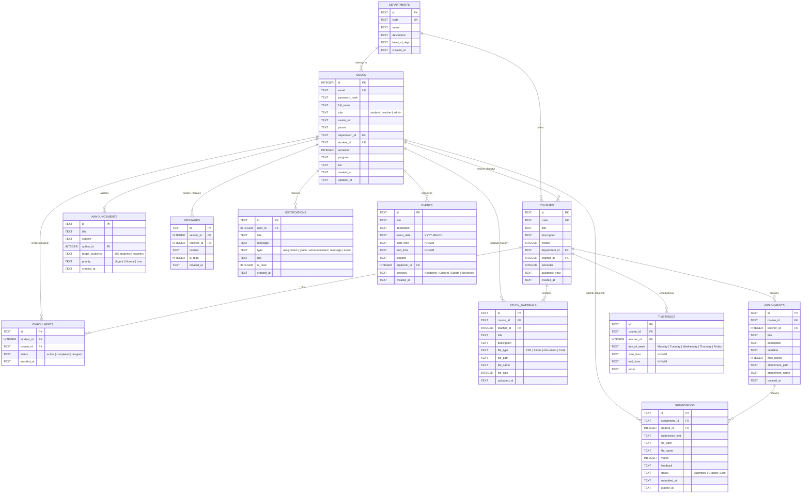

# UniConnect – Relational Database Schema & Data Architecture

This document defines the relational database architecture, schema DDL, entity-relationship diagrams (ERD), constraints, and indexing strategy for **UniConnect**.

---

## 1. Database Engine & Persistence

UniConnect stores application data locally using **SQLite**. 
- Database file path: `%APPDATA%\UniConnect\uniconnect.sqlite` (Windows)
- Encoding: `UTF-8`
- Foreign Key enforcement: `PRAGMA foreign_keys = ON;`
- Journal Mode: `WAL` (Write-Ahead Logging) for concurrent read-write performance
- Isolation: Handled in the Electron main process via secured IPC handlers.

---

## 2. Entity-Relationship Diagram (ERD)



---

## 3. SQL Data Definition Language (DDL) Schema

```sql
-- Enable foreign key constraints
PRAGMA foreign_keys = ON;

-- Departments Table
CREATE TABLE IF NOT EXISTS departments (
    id TEXT PRIMARY KEY,
    code TEXT NOT NULL UNIQUE,
    name TEXT NOT NULL,
    description TEXT,
    head_of_dept TEXT,
    created_at DATETIME DEFAULT CURRENT_TIMESTAMP
);

-- Users Table
CREATE TABLE IF NOT EXISTS users (
    id INTEGER PRIMARY KEY AUTOINCREMENT,
    email TEXT NOT NULL UNIQUE,
    password_hash TEXT NOT NULL,
    full_name TEXT NOT NULL,
    role TEXT NOT NULL CHECK(role IN ('student', 'teacher', 'admin')),
    avatar_url TEXT,
    phone TEXT,
    department_id TEXT REFERENCES departments(id) ON DELETE SET NULL,
    student_id TEXT UNIQUE,
    semester INTEGER DEFAULT 1,
    program TEXT,
    bio TEXT,
    created_at DATETIME DEFAULT CURRENT_TIMESTAMP,
    updated_at DATETIME DEFAULT CURRENT_TIMESTAMP
);

-- Courses Table
CREATE TABLE IF NOT EXISTS courses (
    id TEXT PRIMARY KEY,
    code TEXT NOT NULL UNIQUE,
    title TEXT NOT NULL,
    description TEXT,
    credits INTEGER NOT NULL DEFAULT 3,
    department_id TEXT NOT NULL REFERENCES departments(id) ON DELETE CASCADE,
    teacher_id INTEGER REFERENCES users(id) ON DELETE SET NULL,
    semester INTEGER NOT NULL DEFAULT 1,
    academic_year TEXT DEFAULT '2026-2027',
    created_at DATETIME DEFAULT CURRENT_TIMESTAMP
);

-- Enrollments Table
CREATE TABLE IF NOT EXISTS enrollments (
    id TEXT PRIMARY KEY,
    student_id INTEGER NOT NULL REFERENCES users(id) ON DELETE CASCADE,
    course_id TEXT NOT NULL REFERENCES courses(id) ON DELETE CASCADE,
    status TEXT DEFAULT 'active' CHECK(status IN ('active', 'completed', 'dropped')),
    enrolled_at DATETIME DEFAULT CURRENT_TIMESTAMP,
    UNIQUE(student_id, course_id)
);

-- Assignments Table
CREATE TABLE IF NOT EXISTS assignments (
    id TEXT PRIMARY KEY,
    course_id TEXT NOT NULL REFERENCES courses(id) ON DELETE CASCADE,
    teacher_id INTEGER NOT NULL REFERENCES users(id) ON DELETE CASCADE,
    title TEXT NOT NULL,
    description TEXT NOT NULL,
    deadline DATETIME NOT NULL,
    max_points INTEGER NOT NULL DEFAULT 100,
    attachment_path TEXT,
    attachment_name TEXT,
    created_at DATETIME DEFAULT CURRENT_TIMESTAMP
);

-- Submissions Table
CREATE TABLE IF NOT EXISTS submissions (
    id TEXT PRIMARY KEY,
    assignment_id TEXT NOT NULL REFERENCES assignments(id) ON DELETE CASCADE,
    student_id INTEGER NOT NULL REFERENCES users(id) ON DELETE CASCADE,
    submission_text TEXT,
    file_path TEXT,
    file_name TEXT,
    marks INTEGER,
    feedback TEXT,
    status TEXT DEFAULT 'Submitted' CHECK(status IN ('Submitted', 'Graded', 'Late')),
    submitted_at DATETIME DEFAULT CURRENT_TIMESTAMP,
    graded_at DATETIME,
    UNIQUE(assignment_id, student_id)
);

-- Study Materials Table
CREATE TABLE IF NOT EXISTS study_materials (
    id TEXT PRIMARY KEY,
    course_id TEXT NOT NULL REFERENCES courses(id) ON DELETE CASCADE,
    teacher_id INTEGER NOT NULL REFERENCES users(id) ON DELETE CASCADE,
    title TEXT NOT NULL,
    description TEXT,
    file_type TEXT NOT NULL CHECK(file_type IN ('PDF', 'Slides', 'Document', 'Code', 'Other')),
    file_path TEXT NOT NULL,
    file_name TEXT NOT NULL,
    file_size INTEGER DEFAULT 0,
    uploaded_at DATETIME DEFAULT CURRENT_TIMESTAMP
);

-- Announcements Table
CREATE TABLE IF NOT EXISTS announcements (
    id TEXT PRIMARY KEY,
    title TEXT NOT NULL,
    content TEXT NOT NULL,
    author_id INTEGER NOT NULL REFERENCES users(id) ON DELETE CASCADE,
    target_audience TEXT DEFAULT 'all' CHECK(target_audience IN ('all', 'students', 'teachers')),
    priority TEXT DEFAULT 'Normal' CHECK(priority IN ('Urgent', 'Normal', 'Low')),
    created_at DATETIME DEFAULT CURRENT_TIMESTAMP
);

-- Timetables Table
CREATE TABLE IF NOT EXISTS timetables (
    id TEXT PRIMARY KEY,
    course_id TEXT NOT NULL REFERENCES courses(id) ON DELETE CASCADE,
    teacher_id INTEGER REFERENCES users(id) ON DELETE SET NULL,
    day_of_week TEXT NOT NULL CHECK(day_of_week IN ('Monday', 'Tuesday', 'Wednesday', 'Thursday', 'Friday', 'Saturday')),
    start_time TEXT NOT NULL, -- HH:MM
    end_time TEXT NOT NULL,   -- HH:MM
    room TEXT NOT NULL
);

-- Messages Table
CREATE TABLE IF NOT EXISTS messages (
    id TEXT PRIMARY KEY,
    sender_id INTEGER NOT NULL REFERENCES users(id) ON DELETE CASCADE,
    receiver_id INTEGER NOT NULL REFERENCES users(id) ON DELETE CASCADE,
    content TEXT NOT NULL,
    is_read INTEGER DEFAULT 0 CHECK(is_read IN (0, 1)),
    created_at DATETIME DEFAULT CURRENT_TIMESTAMP
);

-- Events Table
CREATE TABLE IF NOT EXISTS events (
    id TEXT PRIMARY KEY,
    title TEXT NOT NULL,
    description TEXT NOT NULL,
    event_date TEXT NOT NULL, -- YYYY-MM-DD
    start_time TEXT NOT NULL, -- HH:MM
    end_time TEXT NOT NULL,   -- HH:MM
    location TEXT NOT NULL,
    organizer_id INTEGER REFERENCES users(id) ON DELETE SET NULL,
    category TEXT DEFAULT 'Academic' CHECK(category IN ('Academic', 'Cultural', 'Sports', 'Workshop', 'Career')),
    created_at DATETIME DEFAULT CURRENT_TIMESTAMP
);

-- Notifications Table
CREATE TABLE IF NOT EXISTS notifications (
    id TEXT PRIMARY KEY,
    user_id INTEGER NOT NULL REFERENCES users(id) ON DELETE CASCADE,
    title TEXT NOT NULL,
    message TEXT NOT NULL,
    type TEXT NOT NULL CHECK(type IN ('assignment', 'grade', 'announcement', 'message', 'event', 'system')),
    link TEXT,
    is_read INTEGER DEFAULT 0 CHECK(is_read IN (0, 1)),
    created_at DATETIME DEFAULT CURRENT_TIMESTAMP
);
```

---

## 4. Performance Indexes

```sql
CREATE INDEX IF NOT EXISTS idx_users_role ON users(role);
CREATE INDEX IF NOT EXISTS idx_users_dept ON users(department_id);
CREATE INDEX IF NOT EXISTS idx_courses_dept ON courses(department_id);
CREATE INDEX IF NOT EXISTS idx_courses_teacher ON courses(teacher_id);
CREATE INDEX IF NOT EXISTS idx_enrollments_student ON enrollments(student_id);
CREATE INDEX IF NOT EXISTS idx_enrollments_course ON enrollments(course_id);
CREATE INDEX IF NOT EXISTS idx_assignments_course ON assignments(course_id);
CREATE INDEX IF NOT EXISTS idx_submissions_assignment ON submissions(assignment_id);
CREATE INDEX IF NOT EXISTS idx_submissions_student ON submissions(student_id);
CREATE INDEX IF NOT EXISTS idx_study_materials_course ON study_materials(course_id);
CREATE INDEX IF NOT EXISTS idx_timetables_course ON timetables(course_id);
CREATE INDEX IF NOT EXISTS idx_messages_pair ON messages(sender_id, receiver_id);
CREATE INDEX IF NOT EXISTS idx_notifications_user_unread ON notifications(user_id, is_read);
```
