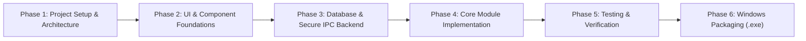

# UniConnect – Development Roadmap & Implementation Plan

This roadmap tracks the structured phases, milestones, deliverables, and verification procedures for the **UniConnect** desktop application.

---

## 📅 Roadmap Overview

---

## Phase 1: Project Setup & Architecture
- [x] Analyze requirements and complete all documentation files.
- [x] Initialize `UniConnect-App` folder structure with clean modular organization.
- [x] Configure `package.json` with Electron, React 18, TypeScript, Tailwind CSS, Lucide Icons, Vite, and Electron Builder.
- [x] Set up Vite configuration with Electron relative path bundling (`base: './'`).
- [x] Configure TypeScript (`tsconfig.json`, `tsconfig.electron.json`) for strict type safety.
- [x] Configure Tailwind CSS and PostCSS for design system styling.

## Phase 2: UI & Component Foundations
- [x] Create core desktop layout shell:
  - Responsive Left Sidebar with role-based navigation.
  - Top Navigation Bar with active page title, search bar, notification center, and user profile pill.
  - Scrollable main content viewport with consistent padding and typography.
- [x] Build reusable UI atomic components:
  - Buttons (Primary, Secondary, Danger, Ghost).
  - Form controls (Input, Select, Textarea, Checkbox) with validation error states.
  - Modal / Dialog overlay with backdrop blur.
  - Data table with sorting, search filtering, and pagination/badges.
  - KPI Stat cards with icons and trend metrics.
  - Empty states and loading spinners.
- [x] Build Authentication screens:
  - Clean Login screen with role selector / demo account quick-fill.
  - Registration screen with role selection and department binding.

## Phase 3: Database & Secure IPC Backend
- [x] Implement embedded SQLite engine via `sql.js` with disk synchronization in `%APPDATA%\UniConnect\uniconnect.sqlite`.
- [x] Write SQL schema initialization script creating all relational tables (`users`, `departments`, `courses`, `enrollments`, `assignments`, `submissions`, `study_materials`, `announcements`, `timetables`, `messages`, `events`, `notifications`).
- [x] Write database seeder with rich, realistic demo data (Admin, Teacher, Student accounts, realistic courses, assignments, timetables, and messages).
- [x] Implement context-isolated `preload.ts` bridge exposing typed `window.api`.
- [x] Implement Electron `ipcMain` handlers for:
  - `auth:*` (login, register, logout, session check).
  - `courses:*` (list, create, update, delete, enrollments).
  - `students:*` (list, create, update, delete).
  - `assignments:*` (list, create, submit, grade).
  - `materials:*` (list, upload, delete).
  - `announcements:*` (list, create, delete).
  - `timetable:*` (list, create, delete).
  - `messages:*` (list threads, send message, mark read).
  - `events:*` (list, create, rsvp).
  - `notifications:*` (list, mark read).
  - `profile:*` (get, update, password change).

## Phase 4: Core Module Implementation
- [x] **Role Dashboards**:
  - Student Dashboard (enrolled courses, urgent assignments countdown, today's schedule).
  - Teacher Dashboard (assigned courses, pending submissions to grade, schedule).
  - Administrator Dashboard (system statistics, department overview, quick management shortcuts).
- [x] **Student Management**:
  - Student table with search, filter by department/semester, add student modal, edit modal, delete confirmation.
- [x] **Course Management**:
  - Course catalog grid, add course modal (with faculty assignment), view enrolled students, delete course.
- [x] **Assignment Hub**:
  - Teacher: Assignment creator modal, deadline picker, submission viewer, grading modal with score & feedback.
  - Student: Assignment list with status badges (Pending, Submitted, Graded), submission modal with file upload simulation and text response, grade/feedback viewer.
- [x] **Study Resources**:
  - Filterable resource repository, category pills (PDF, Slides, Notes, Code), upload modal, download trigger.
- [x] **Announcements**:
  - Feed with priority badges (Urgent, Normal, Low), target audience filtering, compose modal for teachers and admins.
- [x] **Timetable**:
  - Visual 5-day weekly schedule matrix, course badges, classroom indicators, admin schedule builder modal.
- [x] **Direct Messaging**:
  - Conversation list, real-time message thread, send message input, unread count badge, contact search.
- [x] **Events & Activities**:
  - Event calendar cards, category tags (Academic, Sports, Cultural), RSVP button, event creator modal.
- [x] **Notifications**:
  - Dropdown notification tray, unread counter badge, mark all read, direct link navigation.
- [x] **Profile & Settings**:
  - Profile viewer, edit phone/bio, avatar selector, password change with old password verification.

## Phase 5: Testing & Quality Assurance
- [x] Validate all three user roles (Student, Teacher, Admin).
- [x] Verify that every button, form, filter, search bar, and modal operates without console errors.
- [x] Verify database persistence by modifying data, restarting the app, and verifying data is intact.
- [x] Verify validation error handling on forms.
- [x] Verify responsive behavior on desktop window resizing.

## Phase 6: Production Packaging & Windows Installer (.exe)
- [x] Configure `electron-builder` with Windows NSIS target, application icons, and metadata.
- [x] Execute `npm run build` and package executable.
- [x] Verified generated `UniConnect Setup 1.0.0.exe` (95.7 MB) NSIS installer.
- [x] Verified generated standalone portable binary `release\win-unpacked\UniConnect.exe` (188 MB).
- [x] Created root launchers: `UniConnect-Setup.exe` and `Launch-UniConnect.bat`.
- [x] Completed final documentation updates with build outputs.
