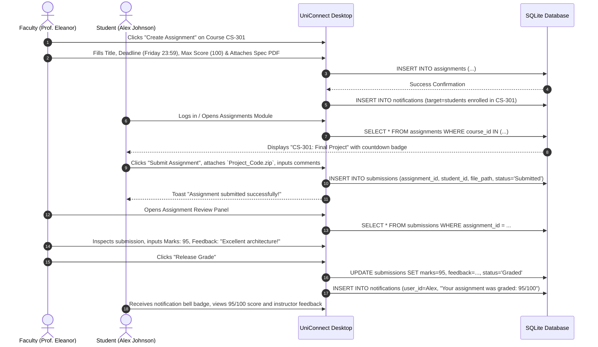
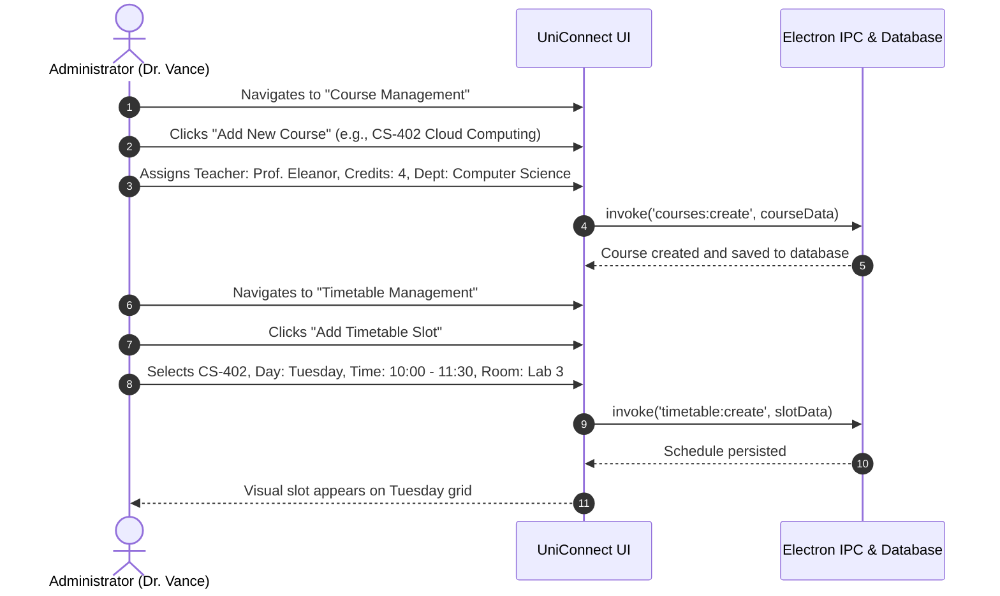
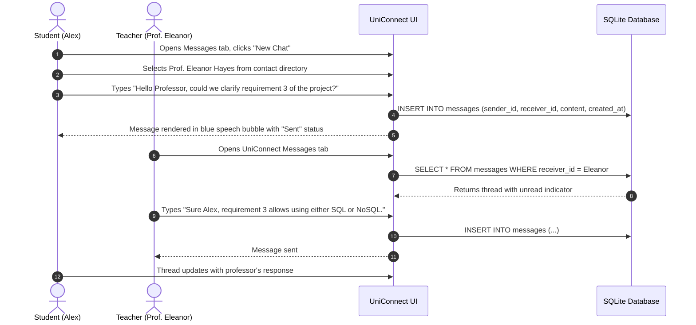

# UniConnect – Feature Specifications & User Flow Documentation

This document specifies all features implemented in **UniConnect**, their operational mechanics, role-based availability, and end-to-end user journeys.

---

## 1. Feature Availability Matrix

The matrix below maps application features against user permissions for **Students**, **Teachers**, and **Administrators**:

| Feature / Capability | Student | Teacher | Administrator | Description |
| :--- | :---: | :---: | :---: | :--- |
| **Authentication & Profile** |
| Register new account | ✅ | ✅ | ✅ | Create new profile with role, email, and password |
| Login & Session persistence | ✅ | ✅ | ✅ | Access platform and stay logged in across app launches |
| View & Edit personal profile | ✅ | ✅ | ✅ | Edit phone, bio, and choose avatar |
| Change account password | ✅ | ✅ | ✅ | Secure password change with verification |
| **Dashboard** |
| Role-specific KPI metrics | ✅ | ✅ | ✅ | View tailored statistics based on role |
| Schedule & Deadlines preview | ✅ | ✅ | ❌ | Preview classes and upcoming tasks |
| System activity overview | ❌ | ❌ | ✅ | University-wide summary statistics |
| **Student Management** |
| View student directory | ❌ | Partial | ✅ | View enrolled students vs. global student registry |
| Add / Edit / Remove students | ❌ | ❌ | ✅ | Full CRUD operations on student profiles |
| View own academic record | ✅ | ❌ | ❌ | View semester, program, and enrolled credits |
| **Course Management** |
| Browse enrolled courses | ✅ | ❌ | ❌ | View course details, instructor, and syllabus |
| Manage assigned courses | ❌ | ✅ | ❌ | View courses taught and student rosters |
| Create / Edit / Delete courses | ❌ | ❌ | ✅ | Global course catalog management |
| Assign teachers to courses | ❌ | ❌ | ✅ | Associate faculty members with courses |
| **Assignments & Grading** |
| View course assignments | ✅ | ✅ | ✅ | Browse assignments filtered by course |
| Create / Edit assignments | ❌ | ✅ | ✅ | Publish assignments with deadline and points |
| Submit assignment solution | ✅ | ❌ | ❌ | Submit answer text and attach solution files |
| Grade submissions & feedback | ❌ | ✅ | ✅ | Input numeric score and evaluation feedback |
| View grades & remarks | ✅ | ✅ | ✅ | Review released scores and instructor feedback |
| **Study Resources** |
| Browse & download resources | ✅ | ✅ | ✅ | Access lecture slides, notes, PDFs, and guides |
| Upload new study materials | ❌ | ✅ | ✅ | Upload documents tagged with course and type |
| Delete study materials | ❌ | ✅ (own) | ✅ (all) | Remove outdated or incorrect documents |
| **Announcements** |
| Read announcements | ✅ | ✅ | ✅ | View broadcasts with priority badges |
| Publish announcements | ❌ | ✅ (dept) | ✅ (global) | Broadcast urgent notices to audience groups |
| Delete announcements | ❌ | ✅ (own) | ✅ (all) | Revoke published announcements |
| **Timetable & Scheduling** |
| View weekly timetable | ✅ (enrolled) | ✅ (teaching) | ✅ (full) | Interactive weekly matrix of classes |
| Add / Edit timetable slots | ❌ | ❌ | ✅ | Configure day, room, instructor, and time slot |
| Conflict detection | ❌ | ❌ | ✅ | Prevent double-booking rooms or instructors |
| **Internal Messaging** |
| Send & receive 1-on-1 messages | ✅ | ✅ | ✅ | Communicate with students, teachers, and admins |
| Search conversations | ✅ | ✅ | ✅ | Filter chat threads by contact name |
| Real-time unread badges | ✅ | ✅ | ✅ | Instant visual notification for new messages |
| **Events & Activities** |
| View university events | ✅ | ✅ | ✅ | Browse upcoming seminars, sports, and workshops |
| Create / Manage events | ❌ | ✅ | ✅ | Schedule events with venue and organizer details |
| RSVP / Mark interest | ✅ | ✅ | ✅ | Indicate intention to attend campus events |
| **Notification Center** |
| In-app notification feed | ✅ | ✅ | ✅ | Real-time alerts for academic updates |
| Mark notifications read | ✅ | ✅ | ✅ | Dismiss or clear all unread alerts |

---

## 2. End-to-End User Workflows

### 2.1 Workflow A: Assignment Lifecycle (Publish -> Submit -> Grade)

---

### 2.2 Workflow B: Course & Timetable Configuration by Administrator

---

### 2.3 Workflow C: Peer & Faculty Messaging

---

## 3. Detailed Acceptance Criteria

To ensure reliable, professional desktop software, every interactive component adheres to strict criteria:

1. **Authentication**:
   - Empty email or password triggers immediate inline validation without backend calls.
   - Invalid credentials display friendly error alerts ("Invalid email or password").
   - Successful login seamlessly transitions to the designated dashboard with zero latency.
2. **Data Mutations (CRUD)**:
   - Creating a record (course, assignment, announcement, event) immediately updates the active UI table/grid without requiring an app reload.
   - Deleting a record always prompts a modal confirmation ("Are you sure you want to delete this course? This action cannot be undone.").
   - Editing preserves unchanged values and immediately reflects updated attributes.
3. **File Management**:
   - File attachment dialogs accept standard file types (`.pdf`, `.docx`, `.pptx`, `.zip`, `.png`, `.jpg`).
   - Uploaded files are copied into the persistent application directory and can be opened or downloaded anytime.
4. **Search & Filters**:
   - Real-time search bars instantly filter table rows and card lists as the user types.
   - Multi-criteria dropdowns (e.g., Filter by Department + Semester) function concurrently.
